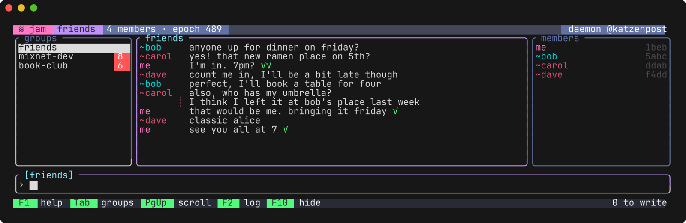

# Tessera

Terminal user interfaces in Lean 4. Its widgets and box layout are inspired by Haskell's
[Brick](https://github.com/jtdaugherty/brick); applications follow the Elm architecture, a state
with a function that draws it and a function that updates it for each message. Terminal input and
control come from [crossterm-lean-ffi](https://github.com/katzenpost/crossterm-lean-ffi).

A group chat over the Katzenpost mixnet, written with Tessera:



```lean
import Tessera
open Tessera Widget

def draw (n : Nat) : Widget .standard .remote :=
  center (borderWithLabel t!" Counter " (padAll 1 (str (.ofNat n ++ t!"   + adds one, Esc quits"))))

def update : Msg Unit → Nat → IO (Nat × Bool)
  | .key (.char '+') _ _, n => pure (n + 1, false)
  | .key .esc _ _, n => pure (n, true)
  | _, n => pure (n, false)

def main : IO Unit := discard <| App.run { draw, update } 0
```

- **Widgets** draw themselves into the space they are given, and their results carry the proof
  that they fit: `str`, `strs`, `txt` (wrapped), `fill`, `hBox`, `vBox`, `border`,
  `borderWithLabel`, `pad`, `hLimit`, `vLimit`, `center`, `viewport`, `withStyle` and `table`. A
  widget is fixed or greedy on each axis; a box gives its fixed children their room first and
  shares the rest among the greedy ones. `Input` is a line editor with history and `ListView` a
  scrolling list with a selection, each with a proof that its cursor or selection stays in view.
- **Styles** set colors (16, 256 or RGB) and bold, dim, italic, underline and reverse. Frames are
  drawn in the colours the terminal shows, or none under `NO_COLOR`, with the program's reserved
  styles still its own.
- **Placement**: frames fill the alternate screen, or take a number of rows below the cursor
  (`placement := .inline n`).
- **Pictures**, as sixel or kitty graphics, encoded by Tessera from pixels; a picture from
  elsewhere is read from PPM with a size cap.
- **Drawing** keeps the last frame and writes only the cells that changed. A cell holds a glyph,
  a character the charset allows, so nothing a terminal would act on can reach one.
- **Text** that widgets draw is a `Text`, which cannot hold a control character, a bidi control
  or an invisible character, and so cannot hold an escape sequence. Text the program wrote comes
  from `t!"…"` literals, checked when the program compiles. Text from elsewhere (a chat message,
  a file name, a name someone chose) goes through `Untrusted.line` or `Untrusted.lines`, which keep
  characters by an allowlist of those the terminal and Tessera agree on the width of, and show
  anything else as a visible stand-in (`␛` for ESC, `␦` for the rest) so that an attempt to steer
  the terminal shows. `Untrusted.Ident` is a name that cannot fake a badge, and its `skeleton` and
  `mixedScript` tell names that look alike. `Untrusted.pasted` removes bracketed paste's markers
  from a paste, and `withoutControls` takes controls and bidi controls out of text passed on.
  [docs/TUI_SECURITY_GUIDELINES.md](docs/TUI_SECURITY_GUIDELINES.md) says what else a TUI showing
  such text should do, and [docs/DESIGN.md](docs/DESIGN.md) how Tessera is built to do it.
- **The trusted path**: the header, status bar, prompt and sender column of a `Frame` are widgets
  of origin `.app`, which hold only text the program wrote; text from elsewhere reaches them only
  cut and delimited by `Widget.delimited`. Senders style their text with a `RemoteStyle`, which
  cannot be one of the program's reserved styles, and a `Roster` labels a room's members so that
  no two look alike.
- **Applications** get keys, pastes, the mouse if they ask, focus changes, resizes, optional
  timer ticks, and events of their own, sent from any task through the function `App.run` passes
  to `start`. Only a key, a paste or a mouse event read from the terminal carries a `UserInput`, from which come the `Designation` that opening a link needs
  and the `Confirmation` an action that cannot be undone needs.
- **Proofs**: no `Text` holds an escape sequence (`VT.text_tokens_print`); a terminal reads
  Tessera's output as its own operations and nothing else (`diff_own`); and on a terminal that
  measures characters as Tessera does, drawing a frame leaves it showing that frame
  (`diff_correct`).

Building needs `cargo` on the `PATH`, for crossterm.

## Try it

    lake exe tessera-demo
    lake exe tessera-demo --inline

## Tests

    make ci

builds everything, checks that no proof uses `sorry` or an axiom beyond Lean's own and that the
programs that must not compile do not, and runs the test suites. `make vterm` checks the output,
and the width of every character Tessera draws, on libvterm (it needs `libvterm-dev`). `make help`
lists the rest.

## Benchmarks

    make bench

times filtering untrusted text, and laying out, diffing and redrawing a chat window, with
[LeanBench](https://github.com/alok/LeanBench). `make bench-text` and `make bench-draw` run one
suite each.

## License

AGPL-3.0-only
