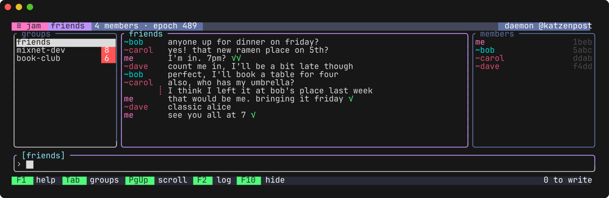

# Tessera

Tessera is a Lean 4 library for terminal user interfaces that show text from other people, such
as chat clients, without letting that text steer the terminal or pass for the program's own.
Applications follow the Elm architecture, a state with a function that draws it and a function
that updates it for each message; widgets and box layout are inspired by Haskell's
[Brick](https://github.com/jtdaugherty/brick). Terminal input and control come from
[crossterm-lean-ffi](https://github.com/katzenpost/crossterm-lean-ffi).



Tessera draws text, styles, boxes, tables, line editors, scrolling lists and sixel or kitty
pictures, on the alternate screen or in rows below the cursor. Text from elsewhere reaches the
screen only as a filtered `Text`, and the compiler rejects a program that puts it where the
program's own text belongs. Tessera does not draw graphical windows, and it is not a terminal
emulator. [docs/FEATURES.md](docs/FEATURES.md) lists what it does in more detail.

## Quick start

Building needs Lean (through [elan](https://github.com/leanprover/elan)) and `cargo` on the
`PATH`, for crossterm.

    lake exe tessera-demo
    lake exe tessera-demo --inline

To use Tessera in a Lake project, add it to `lakefile.toml`:

```toml
[[require]]
name = "Tessera"
git = "https://github.com/katzenpost/tessera"
rev = "main"
```

A counter, which `+` advances and Esc quits:

```lean
import Tessera
open Tessera Widget

def draw (n : Nat) : Widget .standard .remote :=
  center (borderWithLabel t!" Counter " (padAll 1 (str (.ofNat n ++ t!"   + adds one, Esc quits"))))

def update : Msg Unit → Nat → IO (Nat × Bool)
  | .key (.char '+') _ _, n => pure (n + 1, false)
  | .key .esc _ _, n => pure (n, true)
  | _, n => pure (n, false)

def main : IO Unit := discard <| App.run { draw, update } 0
```

## Map

- [Tessera/](Tessera): the library: `Widget`, `App`, `Text` and `Untrusted`, `TrustedPath`, `Consent`, `Diff`, `VT`, `Image` and the rest.
- [Tessera/Tests/](Tessera/Tests): test suites, the axiom check (`Axioms.lean`) and the programs that must not compile (`Rejects.lean`).
- [examples/Demo.lean](examples/Demo.lean): the demo, a list, a line editor and a counter.
- [bench/](bench): benchmarks, a Lake project of their own using [LeanBench](https://github.com/alok/LeanBench).
- [tests/vterm/](tests/vterm): a libvterm screen the `make vterm` check draws on.
- [docs/DESIGN.md](docs/DESIGN.md): how Tessera is built and what its proofs cover.
- [docs/TUI_SECURITY_GUIDELINES.md](docs/TUI_SECURITY_GUIDELINES.md): what a TUI showing text from elsewhere should do.

## Status

Version 0.3.0, on Lean 4.35.0 (`lean-toolchain`), with crossterm-lean-ffi pinned in
`lakefile.toml`. No proof uses `sorry` or an axiom beyond Lean's own. The proofs are stated about
Tessera's model of a terminal; `make vterm` checks the output, and the width of every character
Tessera draws, against libvterm.

## Tests

    make ci

builds everything, checks the proofs and the programs that must not compile, and runs the test
suites. `make vterm` needs `libvterm-dev`; `make bench` runs the benchmarks; `make help` lists the
rest.

## License

[AGPL-3.0-only](LICENSE)
